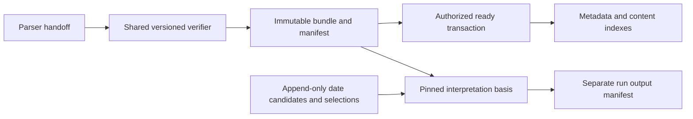

# ADR-0073: Versioned Content Contracts and Append-Only Document Metadata

## Status

- [x] Proposed
- [ ] Accepted
- [ ] Superseded
- [ ] Rejected

**Date:** 2026-10-15\
**Owner:** Architect\
**Scope:** F0004, v0.1A\
**Requirements approval:** operator “proceed with Phase B”, plan run `2026-10-15-bbd8df01`. Phase B design approved by operator `approve-phase-b` on 2026-10-16. Amended in plan run `2026-10-16-fce2ff91` for plan-review `2026-10-16-a186bc18` findings, from four operator decisions (2026-10-16); re-approved with `approve-phase-b`. Amended again in plan run `2026-10-16-06e0131a` for re-review `2026-10-16-b98c71c4` (two operator decisions, 2026-10-16); re-approved with `approve-phase-b`. Corrected in plan run `2026-10-17-620b7618` for full-review gaps; re-approved with `approve-phase-b`. This ADR remains Proposed until its runtime proofs pass.

## Context

Accepted ADR-0003/0004/0040/0059 separate source, content and interpretation, retain the native six-file parse set, and require immutable verified publication. The F0004 amendments add text-origin and document-date storage. ADR-0060/0064/0065 remain Proposed; their broader behavior is not accepted by this record.

The implementation audit found:

- `brain_content.manifest.ArtifactManifest` is strict v1; new mandatory metadata cannot be silently inserted into v1.
- `build_bundle()` emits `source.pdf`, but the published v1 JSON Schema omits that observed filename. The v1 filename enum receives a compatible clarification; no historical bytes or origin/date values are rewritten.
- Async `LocalContentArtifactStore` and synchronous `CheckpointStore` enforce different integrity guarantees. Both must use one verifier.
- The worker derives `version_id` from the parser recipe, while `content_artifact.document_version_id` is unique. That historical representation cannot model a governed replacement artifact of the same source version. Existing identifiers remain stable; new sources and future governed replacements use the explicit identities below.
- Current normalized blocks can repeat one block ID across provenance regions, and tables omit cell/header/continuation detail. V2 records one block with multiple regions and preserves supported table structure.

## Proposed Decision

### 1. Explicit version dispatch; no implicit upgrade

Keep v1 readable with its current hashing algorithm and native evidence vocabulary. Add v2 manifest and block/table/layout contracts; dispatch solely on the declared contract version. Unknown versions fail. V1 remains a legacy read/reuse path; missing historical origins or document dates remain unknown. New v2 writers require actual provenance, never a whole-document OCR guess. **Writer activation:** new sources keep the v1 writer, namespace and identities until a provenance spike on the pinned converter proves per-item origin, and consumers pass v2 compatibility. If the spike fails, v1 remains the writer for new sources and S0002's v2 origin criteria return to the operator. A v2 writer is never enabled with inferred origins. **Per-document fallback:** after activation, a document with any item whose origin the adapter cannot attribute (`ORIGIN_UNAVAILABLE`) publishes a v1 bundle (v1 contract, namespace and `artifact_id = uuid5(version_id, 'content')`) under its §3 source/version identity, with `writer_fallback_reason` recorded on the row and in the publication audit. Other v2 failures still fail the publication.

The v1 schema clarification admits `source.pdf` in addition to the already declared `original.pdf`. V1 bundles without retained source remain readable as historical parsed content; source-dependent operations fail explicitly when the original cannot be resolved. They are never represented as meeting v2 source-retention requirements.

V2 preserves the native JSON and five-file payload inventory (plus manifest as the sixth parse file), requires retained `source.pdf`, and declares any native assets. It records normalized record version, page/coordinate/offset conventions, parser and projection recipe identities, quality and hashes. Failed parsing is a job failure, not a ready v2 bundle; complete/partial quality remains distinct from byte-integrity readiness.

### 2. One verifier for every publisher and reader

`brain_content.validation` is the planned common verifier behind async and sync store adapters. It checks typed shape, exact inventory, unique paths, byte lengths, hashes, required/native assets, source digest, record references and coordinate/offset bounds. Reading a ready row alone does not prove bytes are intact.

**Artifact lifecycle.** `content_artifact.publication_state` is `legacy_unverified`, `ready` or `quarantined`. Pre-F0004 v1 rows start `legacy_unverified` and stay readable through the v1 verifier (bundle hash against `artifact_sha256`, recomputed on every read). A verified backfill moves them to `ready`. A read that hits a definitive verification failure returns 409 `ARTIFACT_INTEGRITY`, and its only write is the failed read decision `AuthorizationExecution.read` already persists (ADR-0062). The operator-run integrity sweep, as the ingestion ServicePrincipal under in-transaction authorization (synchronous `decide` over `SyncAuthorityStore`, with the decision and effects committed together) with `content_artifact:ingest`, re-verifies the bytes and moves the row to `quarantined`. A quarantined row always reads as 409 `ARTIFACT_INTEGRITY`; transient storage errors never quarantine. Every transition is written in one authorized transaction: an append-only state event, the audit event and any repair record, together, with the event's time stamped by the database. A database guard enforces this. Leaving quarantine requires an authorized repair with current ingest authority and full byte re-verification. Anything that needs repair (blocked backfill, integrity failure, orphan marker) gets an append-only repair record owned by DevOps. No API route and no tenant or human grant reads or writes repair records. API, worker and restore paths use the same verifier; corruption is never interpreted as a cache miss and cannot trigger an automatic reparse.

V1 bundle hash remains SHA-256 of concatenated per-file digest strings in sorted path order. V2 bundle hash is SHA-256 of the ASCII JSON serialization of the sorted file-descriptor list, using sorted object keys and separators `(',', ':')`; descriptors contain exactly `path`, `sha256`, `size_bytes`. The manifest is excluded from that inventory to avoid self-reference; PostgreSQL records the SHA-256 of the exact stored manifest bytes separately.

The manifest is published last, then a fenced, currently authorized transaction records ready metadata, normalized indexes and mutation audit. A crash between marker and transaction produces an unadvertised orphan marker; retry verifies and adopts those same bytes without conversion. A database row never makes a partial marker readable. See the assembly plan for recovery states and stale-publisher handling.

### 3. Stable source identity and governed artifact versions

Preserve all existing IDs, foreign keys and v1 namespaces. Existing document versions remain references to their retained source bytes even though their historical IDs included the recipe. Do not merge or rename them during this feature.

For a genuinely new source written by the v2 writer (after activation), the trusted ingestion service resolves `(tenant, KB, source_sha256)` first, assigns `version_id = uuid5(document_id, 'source-v1:' + source_sha256)`, and derives `artifact_id = uuid5(version_id, 'artifact-v2:' + recipe_sha256)`. These are domain IDs, not plan run IDs. A per-document v1 fallback keeps this `version_id`. The v2 recipe covers parser name/package/configuration, projection version, record contract and normalization version. A new extraction profile never changes this recipe.

If any accepted artifact already represents the source, reuse its supported contract. A changed recipe/package does not automatically authorize conversion: require an explicit governed replacement basis or return `PARSER_MIGRATION_REQUIRED`. The model permits several artifact versions per source version; published consumers pin artifact ID. F0004 records replacement lineage and rejects implicit replacement but does not supply a corpus migration executor or approval workflow.

New v2 keys use `bundles/{tenant_id}/{knowledge_base_id}/{artifact_id}/`; v1 keys keep `bundles/{artifact_id}/`. The trusted database contract version and ownership select the namespace. Never search alternate namespaces on a failed authorization or corrupt read. No object-store path is an application permission grant.

### 4. Document dates live outside immutable bundles

Append-only `document_date_candidate` rows preserve date, precision, source basis and correction predecessor. Append-only `document_date_selection` rows record an explicit candidate selection or clearing, its previous selection and actor. The document version is the concurrency lock; an expected-selection token prevents lost updates. There is no date-source priority algorithm. Zero selections, or an explicit clear, means undated. Conflicting candidates remain visible to authorized internal consumers.

Support YEAR, MONTH and DAY precision, with calendar validation and no padding to a finer precision. Original source values remain in the basis. Unsupported subday inputs fail explicitly; this date-only boundary does not implement the broader time-context/resolution contract of F0016.

CONTENT resolves to an actual same-version artifact/block/quote plus immutable JSONL line ordinal and hash, so repeated legacy IDs remain unambiguous without inventing v2 indexes; SOURCE_METADATA preserves the immutable attributable system-field snapshot; HUMAN requires a trusted verification port that binds decision, human actor, document version, exact proposed value and authorization receipt. The default human verifier rejects all receipts. **Selection is human-only in v0.1:** every select or clear carries a verified human selection decision bound to document version, candidate (or clear) and expected previous selection. A service principal may append candidates and may carry that decision, but ingest authority alone never selects (BLUEPRINT §4.11 no-automated-decider guard). F0022 supplies the real human-decision producer; F0004 proves the storage handoff with controlled verifier fixtures and rejects forged/absent authority. No public date-write endpoint or new Casbin grant is added.

An interpretation records the exact selected date record/selection in its run basis when that consumer adopts the contract; later metadata corrections never mutate a prior run. Full F0016 scheduling and re-resolution remain outside F0004.

### 5. Separate run outputs and honest origin

Run manifests remain under their tenant/KB/run namespace, outside parse files. Existing output manifest v1 remains readable; v2 adds pipeline identity and an explicit optional date-selection reference. Configuration/provenance/graph files are run-owned, use current source restrictions and belong in the restore inventory.

Each v2 block has one `STATED`, `OCR`, `TRANSCRIBED` or `DESCRIBED` origin, its producer and an origin-specific anchor or explicit unresolved reason. Missing mixed-page provenance blocks v2 publication; a page OCR count is not a block's origin. Synthetic transcript/description records test storage shapes only. The accepted PDF/BoxSelector review contract is unchanged.



```text
parse -> verify -> immutable bytes + manifest -> authorized DB ready + indexes + audit
                                     |
date candidates -> explicit selection +-> pinned run -> separate run outputs
```

## Alternatives and Consequences

- Adding mandatory fields to v1 would break strict readers and imply historical provenance that was never captured. Separate versions permit staged deployment.
- Editing manifest dates would invalidate immutable evidence hashes. Separate append-only metadata permits corrections and historical replay.
- Retaining two verifiers would preserve inconsistent integrity checks. One verifier needs both worker and API integration tests.
- Replacing historical source/version IDs would risk broken evidence links. Preserve them and use explicit version semantics only for new records.
- Choosing the first/highest-priority date would invent a business rule. Explicit selection adds a concurrency token and preserves conflicts.
- Full-bundle verification adds read I/O. The initial correctness boundary uses no verification cache; later caching requires an immutable object-version proof and separate review. Authorization is never cached across requests.

## Proof Gates Before Acceptance

All F0004 story criteria plus: v1/new-v2 compatibility; byte-for-byte legacy preservation; failure before/after marker and before/after ready commit; stale-worker fencing; cross-owner references; duplicate/racing publication; mixed-origin and multi-region round-trip; partial geometry and Unicode offsets; date append/correction/CAS and forged human receipt rejection; select/clear without a verified human selection decision rejected; the per-item provenance spike exit decision; v1 reads through expand/backfill, a failing read that writes no state, the integrity sweep with its decision and effects in one transaction (quarantine, orphan markers, denial without ingest), per-document v1 fallback with a recorded reason, the lifecycle guard and repair records; current access/revocation; database-plus-byte restore; two-profile restart reuse with converter/OCR entry points forbidden. Changed runtime coverage must meet 80%. A planning schema pass does not satisfy these runtime gates.

## References

- [F0004 PRD](../../features/F0004-content-artifact-model/PRD.md), [assembly plan](../../features/F0004-content-artifact-model/feature-assembly-plan.md)
- [ADR-0040](ADR-0040-lossless-content-and-evidence-contract.md), [ADR-0058 as amended](ADR-0058-evidence-anchoring-and-selector-contract.md), [ADR-0059](ADR-0059-provider-neutral-content-artifact-storage.md)
- [F0003 persistence ownership](../../features/archive/F0003-postgresql-persistence/feature-assembly-plan.md), [F0005 candidate plan](../../features/F0005-one-time-docling-ingestion/feature-assembly-plan.md)
