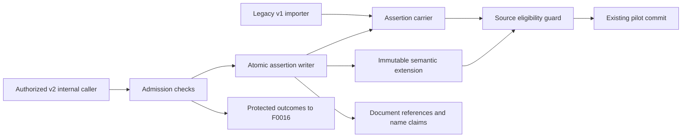

# ADR-0075: Versioned Assertion Semantics and Structural Admission

## Status

- [x] Proposed
- [ ] Accepted
- [ ] Superseded
- [ ] Rejected

**Date:** 2026-11-01
**Owner:** Architect
**Design review:** F0006 Phase B approved by operator token `approve-phase-b` on 2026-11-01, plan run `2026-11-01-7d6d19ce`; correction-basis and correction-persistence amendment re-approved in plan run `2026-11-01-512e9303`. Formal ADR acceptance remains pending the runtime proofs below.
**Formal acceptance:** requires the PostgreSQL migration, native-selector, ownership, legacy consumer and eligibility proofs in the F0006 assembly plan. Plan approval alone is not runtime acceptance.
**Refines:** ADR-0005, ADR-0035, ADR-0063 (accepted direction); implements the bounded F0006 storage/contracts/checks/hooks amendment under Proposed ADR-0065. Does not accept the remaining ADR-0065 obligations.

## Context

The existing assertion carrier has 13 persisted fields, including legacy origin `MACHINE_EXTRACTION`, a proof-scope version counter, value, basis and ownership, but no complete assertion-kind contract, mode, subject reference, ontology release, source wording or admission result. It is used by the F0005 importer and native review correction path. The pilot commit accepts evidence UUIDs and a review-decision UUID; it is not the future F0018 orchestrator. Changing the old payload in place would break strict readers or fabricate historical evidence.

## Decision

### 1. Preserve old records; version new semantics

Keep the legacy result schema and `brain_contracts.result` classes unchanged. A missing result version selects v1; explicit `schema_version: 2` selects the new strict result schema; any other explicit value fails. Never try a permissive parser after a version failure. The F0005 automatic importer stays v1-only and explicitly rejects v2 before mutation until F0016 owns that integration. `direct-baseline` and the v1 content writer remain default.

Add `semantic_contract_version` (default 1) to the assertion carrier. New version-2 writes require a one-to-one immutable `assertion_semantics` extension, checked by a deferred database trigger. Store document-local references and a document-scoped name-claim registry separately. These references are not canonical entities, name FactSlots or entity resolution. Keep the complete validated source record and verified evidence projection in the extension. Never update old origin, evidence, quote, mode or ontology release to make it look like a v2 record.

Legacy read adapters may expose `MACHINE_EXTRACTION -> DOCUMENT_INTERPRETATION` as a labelled compatibility interpretation while returning the original raw origin and version. Missing historical mode/quote/release remain absent. For v2, origin is bound to the trusted producer context; representing all six origins does not register new producers.



```text
v1 importer ----------------------> assertion
authorized v2 -> admission -> writer -> assertion + semantics + local refs/names
                                   \-> review hook
assertion/evidence/review lineage -> eligibility guard -> existing pilot commit
admission outcomes ----------------> F0016 durable-drop/run-lifecycle handoff
```

### 2. Grounding is a deterministic structural check

Normalization `f0006-grounding-v1` uses Unicode NFC, Unicode case folding, whitespace collapse, alphabetic end-of-line hyphen joins, and removal of whitespace immediately adjacent to a currency symbol. The last two case/spacing refinements reconcile EX-SEM-005 with ADR-0065's abbreviated normalization list. It changes no digits, decimal separators, currency identity, words or lexical meaning. Each normalized character maps to its original character range; original text and quotes are retained unchanged.

Locate only in the authorized claimed immutable block. Never use model selectors as authority. A unique match maps back to native selectors under ADR-0058; repeated matches yield a coarser valid selector or unresolved precision rather than a guessed span. Quote presence does not validate the extracted value's meaning.

Run all applicable structural checks and preserve each rejection/signal. `OBJECT_UNDECLARED` converts the supplied source name to a literal and is a signal; truncated/uninterpreted blocks require the future F0016 partial/missingness treatment. F0006 does not create `interpretation_drop` or a full-run completion service.

### 3. Eligibility is a separate, server-derived restriction

Open statements and mood-bearing claims cannot enter resolution or canonical facts. Described-only support requires review and cannot auto-accept, close or supersede facts. Unknown/unqualified or unresolved evidence retains existing provenance review. OCR and transcription are admissible at actual precision; qualified origin is read from verified F0004 records, never a client flag.

The current commit repository resolves supplied managed evidence and review-decision lineage to assertion metadata and correction ancestors before registering a commit or ending a fact. All restrictions are conjunctive. The guard sits inside `CanonicalCommitService.commit`, within the existing authorized transaction, so HTTP and direct application callers share it. Review correction preserves kind, subject, property/release, mood and interpretation basis, unless an explicitly supported v2 correction re-admits changed source evidence. A v1 request cannot strip restrictions from a v2 claim. A v2 correction child is itself a v2 record. It has its own extension, child-owned evidence rows copied from the original (or from re-admitted evidence) and deterministic correction hashes, so the deferred integrity check applies to it unchanged. Corrections of v1 assertions keep the existing EXPLICIT basis as an explicit legacy compatibility boundary. Such rows remain version 1 and confer no v2 eligibility. A reviewer-supplied basis requires a later contract amendment (operator decision 2026-11-01; see the assembly plan).

This guard checks attributable stored sources; it does not infer the origin of an arbitrary submitted number. Existing unregistered pilot evidence UUID behaviour is retained for v1 compatibility; such legacy references cannot be used as a fallback when any referenced evidence/review/correction belongs to v2 or is inaccessible. Full source-completeness and general review-to-canonical orchestration remain F0018 obligations. Tests must include mixed v1/v2 references and correction ancestry to prove restrictions cannot be bypassed through the existing paths.

### 4. Keep the existing transport and authorization boundaries

No assertion HTTP route, new service, queue, external dataset feed, topic or permission grant is introduced. The new boundary is an in-process engine application contract, with JSON Schema for strict payloads and a `Protocol` port for authorized storage. ODCS/AsyncAPI would add a new boundary that this feature does not have. Existing HTTP review/commit schemas remain compatible; OpenAPI documents the new 422 eligibility refusal on commit.

`AuthorizationExecution.mutate` authorizes `content_artifact:interpret` before source reads for internal v2 writes. Review uses current `review_task:annotate`; commit uses current `fact_slot:commit`. Parent/evidence ownership is checked server-side, with structural composite keys as backstops. Extend the existing mutation facade with an optional trusted `additional_reads` discovery callback: after primary action authorization it discovers source IDs/owners only, authorizes their READ actions in the same unit of work, combines all decision audits/rechecks, and only then invokes the mutation. There is no nested read facade that could commit the outer transaction. Existing callers without this callback retain their behaviour. No new actor fields or origin claims are trusted from the model. Protected admission excerpts remain outside general logs, metrics and plain errors.

## Alternatives

- Replacing v1 in place: rejected because strict readers and historical missing fields cannot be reconstructed honestly.
- Storing all fields only in the old value JSON: rejected because typed/open identity, scope and eligibility would be invisible to existing consumers and database guards.
- A new assertion microservice or endpoint: rejected because Phase A requires an internal contract and no new permission surface.
- Wiring full durable drops and open extraction now: rejected by the approved feature scope; these remain F0016/F0066.

## Consequences and Proof Gates

The legacy carrier remains a compatibility projection; v2 semantic meaning comes from its extension. An internal reserved slot sentinel for open statements is never an ontology predicate or a v1 DTO. All old-reader paths must reject this version before projecting it.

Implementation must prove: additive migration and retained old identities; deferred carrier/extension integrity; original-source immutability with only the existing version-counter increment allowed; document name contention on PostgreSQL; all admission reasons; source mapping in PDF/DOCX/XLSX/CSV; atomic rollback/retry; origin/mood/correction guard inheritance; unchanged legacy importer and review behaviour; and at least 80% changed-code coverage. Once v2 records exist, rollback keeps the extension and guard-capable readers; destructive downgrade is refused.

No performance SLO, insurance acceptance rule, model accuracy result or production activation is established by this ADR. See the [assembly plan](../../features/archive/F0006-assertion-plane-origin-and-interpretation-basis/feature-assembly-plan.md), [PRD](../../features/archive/F0006-assertion-plane-origin-and-interpretation-basis/PRD.md) and [worked examples](../../features/archive/F0006-assertion-plane-origin-and-interpretation-basis/worked-examples.md).
