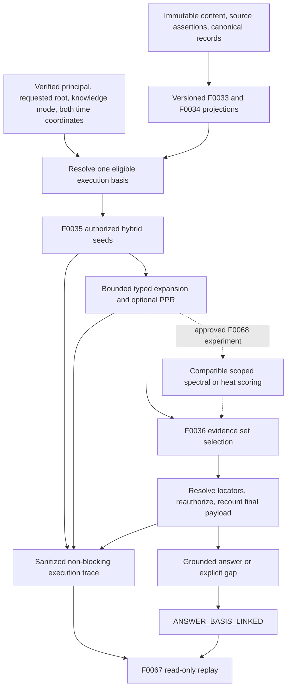

# Governed evidence retrieval and spectral experiments

**Status:** Planning amendment, 2026-11-06. Features remain Planned; this is neither a completed feature plan nor implementation approval. [ADR-0076](decisions/ADR-0076-governed-graph-assisted-evidence-retrieval.md) is Proposed.

The operator requested incorporation of the [spectral graph handoff](nebula-spectral-graph-intelligence-handoff.md) into architecture, design and planning. This document records the incorporation and its remaining decisions. The handoff retains the detailed mathematical and evaluation proposals. Planning baseline: local commit `85384db`, containing the archived F0006 contracts; the existing handoff filename change is preserved.

## 1. User outcome and scope

[Priya the GL Underwriter](../examples/personas/gl-underwriter.md) needs the policy wording, modifying endorsement and effective date together when answering an exclusion question. Ranking passages independently can spend the context window on near duplicates and omit the evidence that changes the answer. A [business reviewer](../examples/personas/business-reviewer.md) needs to inspect the actual answer basis; the [domain steward](../examples/personas/domain-steward.md) owns the meaning of relationships used for expansion.

The v0.2A baseline retrieves an authorized, time-correct evidence set using hybrid seeding, bounded typed expansion and budget-aware context selection. Optional PageRank is a comparator. The v0.4+ F0068 experiment tests spectral coordinates and heat diffusion for additional quality at acceptable cost. Baseline delivery can complete without PPR or spectral scoring. Neither branch admits assertions, decides insurance coverage, mutates ontology, or calculates authoritative amounts through RAG.

The inspiration is **SpectRAG** research, with its official implementation and the independent **SpectraFuse** implementation as references. They are references for native Nebula design, not adopted runtime packages. This amendment does not independently reproduce their benchmark claims.

## 2. Ownership and delivery map

| Feature / horizon | Planning responsibility | Dependency / boundary |
|---|---|---|
| [F0033](../features/F0033-pgvector-retrieval/README.md), v0.2A | Versioned embeddings over persisted content with eligibility inside retrieval (RET-33-01–03) | No new parsing; stable projection identity and independent consumer checkpoint |
| [F0034](../features/F0034-age-graph-projection/README.md), v0.2A | Directed, typed, versioned relationships and per-hop eligibility (RET-34-01–04) | Rebuildable AGE projection; historical queries need compatible topology |
| [F0035](../features/F0035-hybrid-search-and-authorized-scope/README.md), v0.2A | Hybrid fusion, bounded expansion, execution basis, optional PPR (RET-35-01–09) | F0033/F0034 contracts before Phase B approval; delivered adapters before production integration |
| [F0036](../features/F0036-evidence-aware-retrieval-and-grounded-generation/README.md), v0.2A | Exact evidence budget, locator revalidation, gaps and answer-basis linkage (RET-36-01–08) | Settled F0035 interface; answer model profile decided here |
| [F0067](../features/F0067-graph-observatory/README.md), v0.2B | Read recorded retrieval diagnostics (RET-67-01) | Consumer only; recording does not wait for rendering |
| [F0068](../features/F0068-spectral-graph-retrieval-experiments/README.md), v0.4+ | Conditional spectral/heat artifacts, scoring, ablations and promotion evidence | Separate experiment decision after baseline measurement; no dependency from the baseline to F0068 |
| [F0061](../features/F0061-advanced-retrieval/README.md), v0.4+ | Existing dense+sparse, multivector, reranker and optional Qdrant work | Useful comparator when available; not renamed or required by F0068 |

The Product Manager owns scope, feature reservations, sequencing and later stories. The Architect owns this design, ADRs and architectural KG bindings. Security owns the authorization threat model and cache/replay rules. The AI Engineer owns proposed ranking/model profiles and numerical design. The Quality Engineer owns corpus isolation, comparison protocols and evidence requirements with the PM. Role guidance is consumed from sibling `nebula-agents/agents/{product-manager,architect,security,ai-engineer,quality-engineer}/SKILL.md`; this amendment does not claim independent role signoffs or a completed plan-action run.

## 3. Derived plane and execution

Source/canonical records retain authority. A retrieval derivative cannot write accepted facts. Indexing reads the persisted parse-once content bundle, preserves v1/v2 dispatch and never upgrades missing legacy provenance or `unresolved` locator precision. Original relationship direction and type survive; numerical symmetrization is confined to F0068 derivatives.

Prefer the already planned `engine/packages/brain-search/` for fusion, expansion and selection, and `brain-graph/` for projection adapters. These are proposed locations, not existing implementations. D6 must settle package ownership before Phase B approval; a separate `brain-retrieval` package needs a recorded reason. Pure math must remain independent of storage and serving. No solver import is required for the baseline. Actual answer generation follows the approved Neuron/conversation boundary.

## 4. Contract design to bind during Phase B

Reuse existing `OwnedScope`, principal, requested-scope, resource-envelope, temporal and artifact types; the handoff's names are semantic placeholders, not a second identity model.

| Contract | Required semantics | Planning owner |
|---|---|---|
| Evidence block reference | Immutable artifact/version/block identity, content contract version, locator and precision, zero-or-many assertion/canonical binding refs; ownership is not a grant | F0033/F0036 |
| Typed evidence edge | Original direction/type, raw signals, construction recipe and exact input versions, including edge/evidence dependency authorization | F0034/F0035 |
| Retrieval execution basis | Snapshot; precision-aware `valid_as_of`/`known_as_of`; root/scope; knowledge mode; current authorization revisions; ontology/content/profile versions; actual projection IDs; effective retrieval mode; model/tokenizer profile | F0035/F0036 |
| Evidence context | Selected references, binding/locator precision, selection reasons and paths, sanitized considered-not-selected references, complete serialized token count/hash, gaps and fallback reasons | F0036 |
| Spectral projection manifest | Exact authorized corpus and temporal/mode basis; node map, adjacency/eigenpair hashes, algorithm/profile/model revisions, validation and publication state | F0068 only |

`knowledge_mode` (`canonical`, `source`, `scenario`) is distinct from Fact Mode and assertion mood. Source mode can retrieve superseded wording subject to recorded availability and current access; canonical mode resolves applicable accepted bindings at both coordinates. Retrieval never confers admission. Scenario mode requires its explicit scenario contract and rejects until supported.

Baseline modes are `hybrid_only` and `graph_expand`. `graph_ppr` is optional. F0068 owns `graph_spectral`, `graph_heat`, `graph_ppr_spectral` and benchmark-only `spectral_no_expansion`. Reject unknown, disabled or unimplemented modes. A supported mode with unavailable/incompatible inputs takes a recorded compatible authorized fallback, or returns a gap. A missing backend never permits an unfiltered query; today's AGE graph is not a historical fallback.

Eligibility constrains seeds, intermediate vertices, edges, dependencies, ranking inputs, counts, facets, logs and traces **before influence**. Broader grants never broaden a requested account/document root. Pin one consistent semantic read basis and record each adapter's version/checkpoint. Refresh current authority at the final evidence boundary; a recorded authorization decision is not a reusable grant. F0033/F0034 must define consumer-specific checkpoint/rebuild/cutover semantics rather than sharing the current outbox worker's processed marker.

For F0068, a tenant match alone is insufficient. A stored basis must exactly match the request's authorized influence domain, root, mode, snapshot, both time coordinates/precision, ontology/content/edge/model versions and policy/grant/resource/dependency revisions. On mismatch, use a compatible baseline or an explicitly approved bounded query-local experiment. Never slice rows from an incompatible global eigenbasis. Publish checked artifacts atomically from BUILDING to READY; retain version references for audit under policy. Rollback still checks current compatibility.

F0036 resolves the evidence budget as the minimum of the request and model window remaining after fixed input, reserved output and safety margin. Pin the exact tokenizer revision; tokenize the final serialized evidence including wrappers/citations after grouping and reauthorization. Reject non-positive budgets. Preserve table rows and effective clauses, protect required anchors/bridge evidence, and report missing coverage explicitly. Removed evidence requires recomputed coverage, gaps, backfill and token count under the same scope and snapshot.

Rank/selection scores are not truth probabilities. Only the grounded answer's `ANSWER_BASIS_LINKED` identifies used evidence. Traces record sanitized operation facts and completeness, not source text, private topology summaries or model chain-of-thought. Recording failure does not fail the answer. F0067 reauthorizes every replay read.

## 5. Evaluation before spectral work

The [evaluation strategy](../testing/evaluation-strategy.md#governed-retrieval-and-spectral-experiment-evaluation) carries the handoff's corpus, ablations and release criteria. Start the runner and synthetic fixtures before retrieval implementation; measure each real adapter as it arrives. Synthetic adapters prove interfaces only. Development examples EX-RET-001–006 stay outside the holdout.

Run hybrid top-k, budget-aware hybrid, and hybrid plus expansion first (A–C). Add PPR (D) only if implemented; add spectral/heat/ensemble/no-expansion ablations only under F0068. Hold candidate sets fixed for scoring-only comparisons and give the strong hybrid baseline comparable candidate caps, token budget and tuning effort. Report complete evidence-set recall, bridge recall, grounded answer/citation quality, abstention, latency, memory/build cost and paired confidence intervals. Do not attribute expansion/selector gains to eigensolvers.

Spectral math proofs include all trivial modes in disconnected graphs, no diffusion across components, isolated/small graphs, sparse scale behavior, residual/orthogonality checks, subspace invariance for repeated eigenvalues and heat against a small exact exponential. Nontrivial proximity coordinates and heat diffusion have different zero-mode requirements. Optional PPR is row-stochastic with explicit sinks, restart, conservation and convergence.

Governance invariants are hard gates. Numeric tolerances, worthwhile gains and operating budgets remain to be pre-registered after baseline measurement and before held-out scoring. Spectral promotion requires separate cost/scope approval, permission-safe shadow evidence, limited opt-in and owner approval; becoming the default is another decision. A measured decision to retain the baseline is a valid outcome.

## 6. Decisions and remaining feature planning

| Handoff decision | Disposition in this amendment | Next owner / gate |
|---|---|---|
| D1 carry-in | Incorporated into F0033–F0036/F0067 READMEs as numbered Phase A inputs under the operator's request | PM: convert to PRDs/stories in each plan action |
| D2 ADR draft | ADR-0076 drafted, Proposed; no acceptance or Phase B approval asserted | Architect + Security: settle interfaces/proofs at F0035 Phase B |
| D3 experiment home | Reserve F0068 at v0.4+ using the handoff's recommended separate feature; F0061 keeps its scope | PM/operator: later experiment scope, scheduling, cost and activation decisions |
| D4 corpus/runner | QE + PM own it; fixture/runner work precedes measured baseline and spectral work | F0035 Phase A confirms corpus distribution, labels, split and ownership |
| D5 model profile | Open: window, exact tokenizer, fixed-input accounting and output reserve | AI Engineer + Architect, F0036 Phase B |
| D6 package placement | Proposed brain-search/brain-graph split; final placement open | Architect, F0035 Phase B |
| D7 edge weights/profiles | Handoff weights are hypotheses, not approved defaults or insurance rules | AI Engineer + domain steward, F0035 Phase B and held-out tuning protocol |
| D8 checkpoints/rebuild | Open: per-consumer identities, coherent snapshot, replay and atomic cutover | Architect, F0033/F0034 Phase B, before F0035 Phase B approval |
| D9 cache/replay | Exact compatibility and current-authority requirements carried in; concrete keys/invalidation/read rules open | Security, F0035 Phase B |

F0035 Phase A may clarify the user need first. Settle F0033/F0034 contracts before F0035 Phase B approval, then bind F0036 to that interface. Each feature still needs its own PRD, STATUS, stories, schemas, assembly plan, plan-review and phase approvals. This amendment creates none of those approvals and does not move a feature to Now. Architectural KG links are authored in `kg-source/`; planning reservations retain coverage exclusions until substantive Phase B mappings exist. The handoff's PR-02–06/09 baseline and conditional PR-07–08 delivery sequence remains the implementation outline after those gates.
