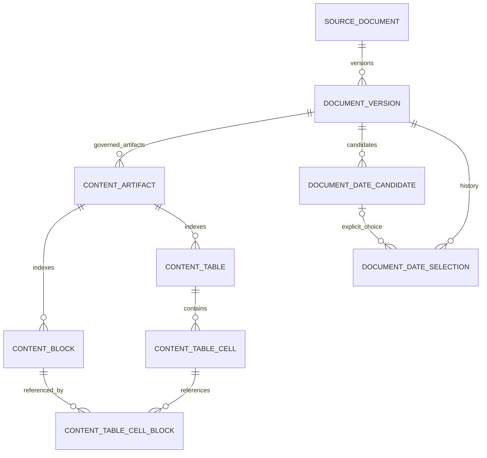
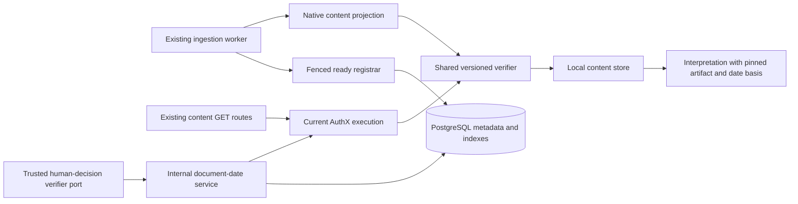

# F0004 — Content artifact model

**Status:** Planned
**Phase:** v0.1A
**Roadmap:** Next

## Overview

The content artifact contract (native DoclingDocument plus normalized views, blocks, coordinates, manifest) is what parse-once preserves and what every interpretation reads (sections 5, 80, 81, 108). ADR-0060 separates immutable parse artifacts from Docling-Graph interpretation outputs.

Source: `planning-mds/architecture/master-blueprint.md` section 95 (epic roadmap) and section 115.3 (sequencing). Governing ADRs: [ADR-0003](../../architecture/decisions/ADR-0003-one-time-content-extraction.md), [ADR-0004](../../architecture/decisions/ADR-0004-source-content-artifact-and-interpretation-are-separately-versioned.md), [ADR-0040](../../architecture/decisions/ADR-0040-lossless-content-and-evidence-contract.md).

## Documents

Phase A was approved by the operator (“proceed with Phase B”) in plan run `2026-10-15-bbd8df01`. Phase B architecture was explicitly approved with `approve-phase-b` on 2026-10-16. Plan-review run `2026-10-16-a186bc18` returned CONDITIONALLY READY. Plan run `2026-10-16-fce2ff91` reworks its findings: both phases re-approved with `approve-phase-a` and `approve-phase-b` on 2026-10-16. Re-review run `2026-10-16-b98c71c4` returned CONDITIONALLY READY; plan run `2026-10-16-06e0131a` reworks R-H1, R-M1 and R-L1; both phases re-approved with `approve-phase-a` and `approve-phase-b` on 2026-10-16. Plan run `2026-10-17-620b7618` fixes six full-review gaps; both phases re-approved on 2026-10-17. Implementation has not started.

- [Assembly plan](feature-assembly-plan.md) — interfaces, transactions, migration and proof matrix
- [Getting started](GETTING-STARTED.md) — implementation handoff and planning checks
- [ADR-0073](../../architecture/decisions/ADR-0073-versioned-content-contracts-and-document-metadata.md) — proposed versioning and append-only date decisions
- [Persistence design](persistence-design.sql) — proposed SQL, not an applied migration
- [Contract examples](contract-examples.json) and [validator](validate-contract-examples.py) — synthetic schema conformance
- [PRD](PRD.md) — requirements and scope boundaries
- [Personas](personas.md) — existing product personas applied to this feature
- [Acceptance checklist](acceptance-criteria-checklist.md)
- [Worked examples](worked-examples.md) — synthetic planning expectations
- [Status](STATUS.md) — planning position and empty implementation signoff history

## Stories

| ID | Title | Status |
|----|-------|--------|
| [F0004-S0001](F0004-S0001-publish-and-reuse-content-bundle.md) | Publish and reuse an immutable content bundle | Not Started |
| [F0004-S0002](F0004-S0002-content-structure-and-text-origin.md) | Preserve content structure and text origin | Not Started |
| [F0004-S0003](F0004-S0003-document-date-provenance.md) | Preserve document-date provenance | Not Started |
| [F0004-S0004](F0004-S0004-authorized-consumers-and-compatibility.md) | Protect artifact consumers and compatibility | Not Started |

**Total Stories:** 4

## Docling-Graph scope amendment (2026-09-15)

[ADR-0060](../../architecture/decisions/ADR-0060-docling-graph-document-pipeline-orchestration.md) governs this planned work. Carry these requirements into the feature PRD/stories; status remains Planned.

- Keep the six-file parse bundle and parser identity from ADR-0040. Record Docling-Graph pipeline revision/configuration separately; the converter remains Docling.
- Publish and hash-verify the bundle through ContentArtifactStore. Store graph, provenance ledger, and effective extraction configuration as run-owned outputs; a new profile must not mutate the content artifact.
- Preserve source and bundle access controls, retention, and backup/restore coverage for the additional run outputs.

## Statements, time, and governance scope amendment (2026-09-25)

[ADR-0064](../../architecture/decisions/ADR-0064-time-interpretation-and-valid-time-precision.md), [ADR-0065](../../architecture/decisions/ADR-0065-assertion-admission-text-origin-and-mood.md) govern this planned work. Carry these requirements into the feature PRD and stories when the feature is planned; the feature status is unchanged. Examples: [statements, time, and governance](../../examples/statements-time-and-governance.md).

- Store the document's own date with its source (`CONTENT`, `SOURCE_METADATA`, `HUMAN`). Upload, sync, and receipt times are recorded-time facts and never a document date (ADR-0064).
- Content blocks carry `text_origin` (`STATED`, `OCR`, `TRANSCRIBED`, `DESCRIBED`), the producing engine/model/version, and an origin-specific anchor. A block never mixes origins (ADR-0065).
- **v0.1 scope guard (validate finding P-2):** this feature's Phase A admits only the storage fields, contract checks, and review/display hooks listed here. Alignment, automated deciders, fingerprint-driven scheduling, and time-mention resolution that replaces template fields stay in v0.2+ unless the operator amends the scope (BLUEPRINT §4.11).

## Proposed entity relationships

All content/date children retain tenant and knowledge-base ownership. A source version may have several explicitly governed artifacts; legacy identities remain stable. Bytes and full text stay in the content store; indexes point to exact immutable JSONL lines. Dates belong to the source version, outside bundle hashes.



```text
source document -> document version -> artifact -> blocks
                           |               +----> tables -> cells -> block links
                           +-> date candidates -> explicit selections / clear
                                                  |
                                                  +-> pinned run basis (separate outputs)
```

## Component view within existing containers



```text
existing worker -> projection -> shared verifier -> local immutable bytes
       |                               ^
       +-> fenced ready registrar      +-- current AuthX <-- existing API reads
                     |                         ^
                     v                         |
              PostgreSQL <--- internal date service <--- trusted verifier port
```

The human verifier has a rejecting default. The diagram is proposed internal composition, not a new public entry point. Existing [C4 context](../../architecture/c4-context.md) and [container](../../architecture/c4-container.md) boundaries remain unchanged.
