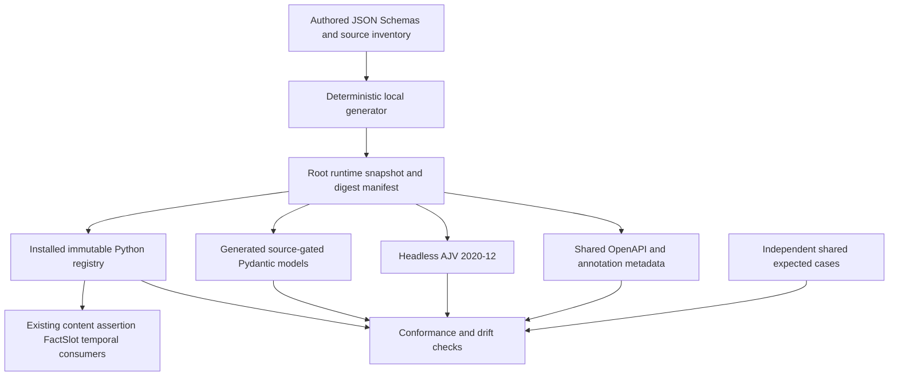
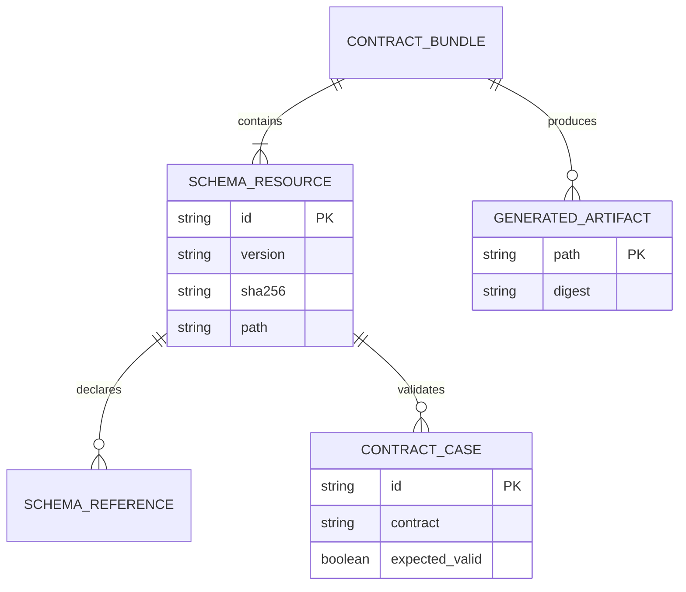

# F0011 — JSON Schema contract system

**Status:** Planned
**Phase:** v0.1A / MVP
**Roadmap:** Now (2026-11-20 roadmap review)
**Planning:** Phase A and Phase B approved by the operator on 2026-11-20; implementation Not Started.
**Plan Run:** `2026-11-20-ccb1bd39`

## Overview

Publish one versioned JSON Schema 2020-12 structural contract foundation with
Python/Pydantic/AJV/OpenAPI conformance and compatible adoption by existing
consumers. Information-state, qualified-money and scoped-identifier schemas retain
the shipped F0007 semantics. No user-visible screen is introduced.

## Requirement-ownership amendment (2026-11-08)

- **Dependencies:** F0001, F0006 (previously F0001).
- Publish JSON Schema 2020-12 definitions for the ADR-0039 information state,
  qualified money and scoped identifier, with failure fixtures.
- ADR-0039 remains Proposed pending all of its acceptance proofs, including the
  later F0023 incomplete-package display; schema publication alone cannot accept it.

Source: master blueprint sections 25–27, 95, 98, 106.3, 112 and 115.3.
Governing baseline: [ADR-0013](../../architecture/decisions/ADR-0013-json-schema-is-the-structural-contract.md).

## Documents

- [PRD](PRD.md) — requirements and boundary ownership; review this for Phase A.
- [Personas](personas.md) — feature-scoped jobs for existing engineering personas.
- [Acceptance checklist](acceptance-criteria-checklist.md) — 41 ACs across six stories.
- [Status](STATUS.md) — implementation remains Not Started; no signoff claims.
- [Getting started](GETTING-STARTED.md) — planning state and future proof prerequisites.

## Architecture review packet

- [Assembly plan](feature-assembly-plan.md) — exact proposed files, interfaces,
  logic, transaction/error mapping, ownership, commands and all 41 AC proof ranges.
- [Contract design](contract-design.md) — source authority, subset, compatibility,
  Pydantic/AJV/OpenAPI integration and primary technical sources.
- [Inventory](contract-inventory.yaml) — 21 payload resources and retained boundaries.
- [Validation profile](schema-validation-profile.yaml) — keyword/format/annotation,
  reference, resource and new-portable versus native-compatibility policies.
- [Synthetic expectations](contract-examples.json) — 74 design cases; local schema
  validation is not AJV/Pydantic/installed-package/consumer proof.
- [ADR-0079](../../architecture/decisions/ADR-0079-offline-schema-bundle-and-cross-language-conformance.md)
  — Proposed pending runtime proofs and explicit later acceptance.

No database registry/migration, new deployable, route, grant or UI is required.
Existing [C4 context](../../architecture/c4-context.md) and
[container](../../architecture/c4-container.md) diagrams still apply.

## Component view



```text
authored schemas -> deterministic build -> root snapshot
                                   |-> installed Python registry -> current consumers
                                   |-> source-gated Pydantic
                                   |-> AJV / OpenAPI / metadata
shared expected cases -------------> conformance + drift checks
```

## Artifact relationships

This is an artifact model, not a new database ERD. No business entity or persisted
relationship changes. Schema references are closed lookup edges in the bundle.



```text
ContractBundle 1 ---- many SchemaResource (id, version, digest)
SchemaResource 1 ---- many Reference / ExpectedCase
ContractBundle 1 ---- many GeneratedArtifact
```

## Approval and proof boundary

Phase A approved by operator response `approve`, recorded as `approve-phase-a`
at G3. Phase B approved by operator token `approve-phase-b` at G5 on 2026-11-20.
ADR-0079 and ADR-0039 remain Proposed pending their runtime proofs and later acceptance.
All six stories are Not Started; runtime capability, conformance and security
claims wait for the feature action and its independent reviews.

## Stories

| ID | Title | ACs | Status |
|----|-------|-----|--------|
| [F0011-S0001](F0011-S0001-resolve-versioned-offline-contracts.md) | Resolve versioned offline contracts | 7 | Not Started |
| [F0011-S0002](F0011-S0002-validate-information-state-and-scoped-absence.md) | Validate information state and scoped absence | 7 | Not Started |
| [F0011-S0003](F0011-S0003-validate-qualified-money-and-scoped-identifiers.md) | Validate qualified money and scoped identifiers | 7 | Not Started |
| [F0011-S0004](F0011-S0004-prove-cross-language-contract-conformance.md) | Prove cross-language contract conformance | 7 | Not Started |
| [F0011-S0005](F0011-S0005-preserve-existing-consumer-contracts.md) | Preserve existing consumer contracts | 7 | Not Started |
| [F0011-S0006](F0011-S0006-verify-reproducible-contract-delivery.md) | Verify reproducible contract delivery | 6 | Not Started |

**Total Stories:** 6
**Total Acceptance Criteria:** 41
