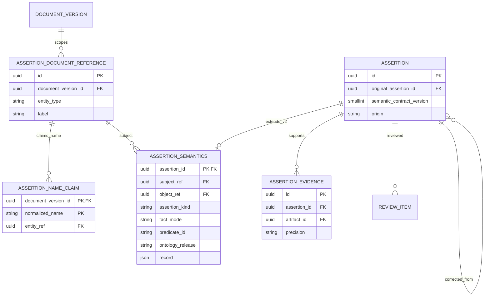
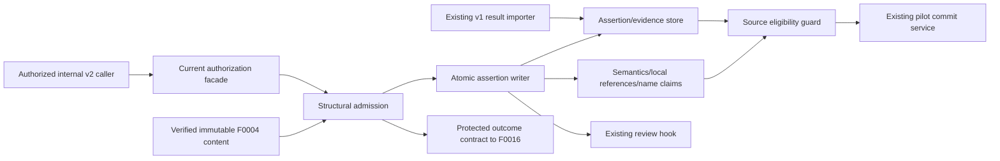

# F0006 — Assertion plane + origin + interpretation basis

**Status:** Done / Archived
**Phase:** v0.1A
**Archived:** 2026-11-05
**Feature run:** `2026-11-02-5a00b0ff` — trusted local synthetic-fixture completion; SEC-01 mitigation accepted by the operator
**Roadmap:** Completed

## Overview

The assertion plane records what sources claim before anything becomes truth; origin and interpretation basis are first-class from the first extraction (section 11).

Source: `planning-mds/architecture/master-blueprint.md` section 95 (epic roadmap) and section 115.3 (sequencing). Governing ADRs: [ADR-0005](../../../architecture/decisions/ADR-0005-three-plane-knowledge-model.md), [ADR-0035](../../../architecture/decisions/ADR-0035-interpretation-basis-is-first-class.md).

## Documents

- [PRD](PRD.md) — Phase A approved by operator `approve-phase-a` on 2026-11-01; five stories and 35 ACs.
- [Personas](personas.md), [acceptance checklist](acceptance-criteria-checklist.md), [status](STATUS.md), [getting started](GETTING-STARTED.md).
- Plan run: `2026-11-01-7d6d19ce` (A+B, new). Phase A+B approved by operator on 2026-11-01. The approved design is implemented and all five stories / 35 ACs have runtime evidence in the feature run. Phase B rework for plan-review findings AR-1/AR-2 (correction basis and v2 correction persistence) was re-approved with `approve-phase-b` in plan run `2026-11-01-512e9303`.
- Feature shard: `planning-mds/kg-source/features/F0006.yaml`; Architect-authored as-built mappings cover the implemented source and tests; G7 compilation, symbol/decision regeneration and drift validation passed. The PM archive checkpoint moves this feature to Archived / Completed.
- [Assembly plan](feature-assembly-plan.md) — Phase B design approved 2026-11-01; implementation files, signatures, migration constraints, authorization, consumer guards and verification matrix.
- [ADR-0075](../../../architecture/decisions/ADR-0075-versioned-assertion-semantics-and-admission.md) — Proposed; bounded versioned semantics and admission design. [Worked examples](worked-examples.md), [structured contract examples](contract-examples.json).

## Stories

| ID | Title | Status |
|----|-------|--------|
| [F0006-S0001](F0006-S0001-preserve-typed-source-claims.md) | Preserve typed source claims | Done |
| [F0006-S0002](F0006-S0002-retain-open-statements-and-version-contracts.md) | Retain open statements and version contracts | Done |
| [F0006-S0003](F0006-S0003-check-structural-admission-and-evidence.md) | Check structural admission and evidence | Done |
| [F0006-S0004](F0006-S0004-guard-mood-and-described-evidence.md) | Guard mood and described evidence | Done |
| [F0006-S0005](F0006-S0005-preserve-existing-consumer-boundaries.md) | Preserve existing consumer boundaries | Done |

**Total Stories:** 5

## Phase B design: feature ERD

As-built additive storage (migration 0011), verified in the feature run. The earlier plan itself applied no migration. The original Assertion and AssertionEvidence identities survive. Document-local references and admission name claims do not establish canonical entities or name FactSlots.



```text
document version -> local references -> unique document name claims
                         | subject/object
assertion 1 -------- 0..1 semantics (required exactly once for version 2)
    | 1..n evidence          | full record + verified selectors/origins
    +----- review item       +----- eligibility guard
    +----- corrected assertion (additive; restrictions inherited)
```

## Phase B component design



Existing [C4 context](../../../architecture/c4-context.md) and [container topology](../../../architecture/c4-container.md) remain unchanged. Engine owns this application contract and storage; neuron keeps the v1 producer path. No model, new service or UI is added by the design. See the assembly plan for direct backend/QE/security/DevOps/Architect handoffs.

## Statements, time, and governance scope amendment (2026-09-25)

[ADR-0063](../../../architecture/decisions/ADR-0063-open-statements-and-signature-alignment.md), [ADR-0065](../../../architecture/decisions/ADR-0065-assertion-admission-text-origin-and-mood.md) govern the scope implemented by this feature. The requirements below are reflected in the PRD, five completed stories and observed runtime evidence; broader Proposed ADR proof gates remain separate. Examples: [statements, time, and governance](../../../examples/statements-time-and-governance.md).

- Persist both assertion kinds: `OPEN_STATEMENT` (subject, source relation phrase, object or literal, role-word qualifiers, time-mention references, mandatory quote, nullable predicate) and `TYPED_ASSERTION` (ontology property and release). v0.1 acceptance runs on the template route; open extraction and alignment ship in F0066 (ADR-0063).
- Define the admission service contract: quote-in-block, name-in-quote, time-words-in-quote, and name-claimed-by-another checks; server-computed selectors; drop reasons (ADR-0065).
- Add the `mood` qualifier. Mood-bearing statements are never eligible for canonical facts; an issued policy's operative provisions remain contract facts (ADR-0065, EX-SEM-007).
- **v0.1 scope guard (validate finding P-2):** this feature's Phase A admits only the storage fields, contract checks, and review/display hooks listed here. Alignment, automated deciders, fingerprint-driven scheduling, and time-mention resolution that replaces template fields stay in v0.2+ unless the operator amends the scope (BLUEPRINT §4.11).
- **Schema versioning (validate finding A-5):** `schemas/interpretation-result.schema.json` sets `additionalProperties: false`. Assertion kind, source phrase, quote and selector, role-word qualifiers including mood, and time-mention references need a versioned schema addition with compatible readers; existing results stay valid.

## Completion and Accepted Follow-ups

[PM closeout](../../../operations/evidence/runs/2026-11-02-5a00b0ff/pm-closeout.md) and [QE evidence](../../../operations/evidence/runs/2026-11-02-5a00b0ff/test-execution-report.md) record 35/35 ACs, 336 unique final-lane passing cases and 92.4171% changed executable-line coverage. SEC-01 remains an open High risk accepted only for trusted local synthetic fixtures; dependency remediation and verified resource isolation are required before untrusted/production PDFs (AI Engineer + DevOps, Security verification, target 2026-11-10). SEC-02/03 carry explicit owners and follow-up dates in STATUS.md and the Security report. No new producer, UI, grants or extraction activation is part of this completion.
