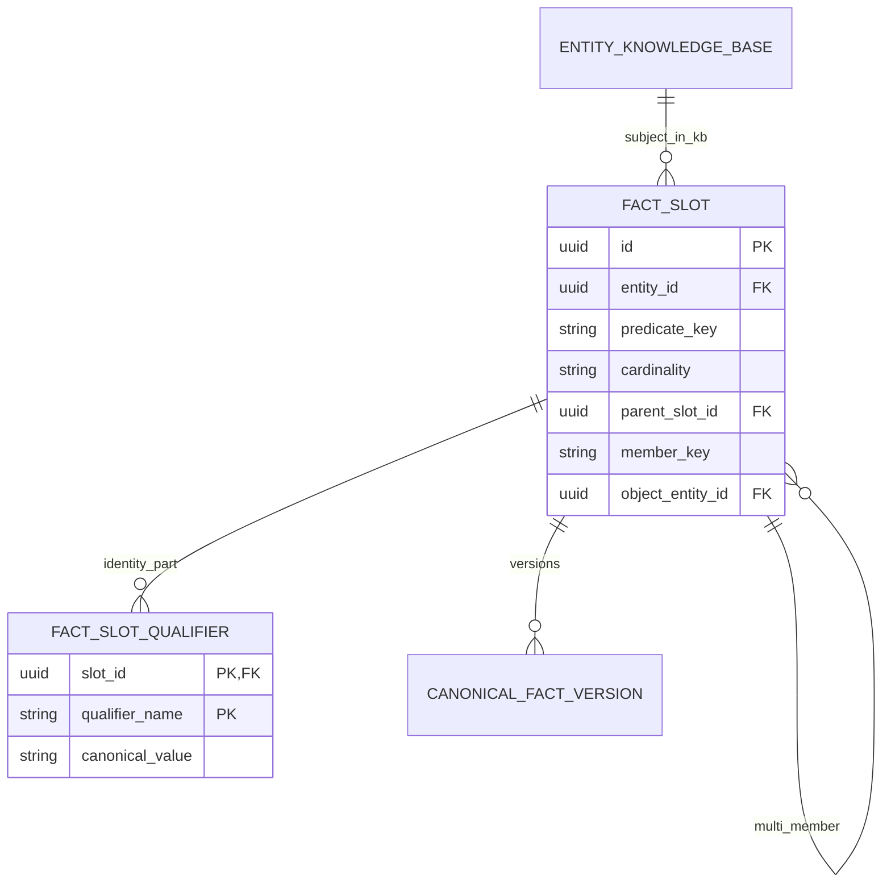
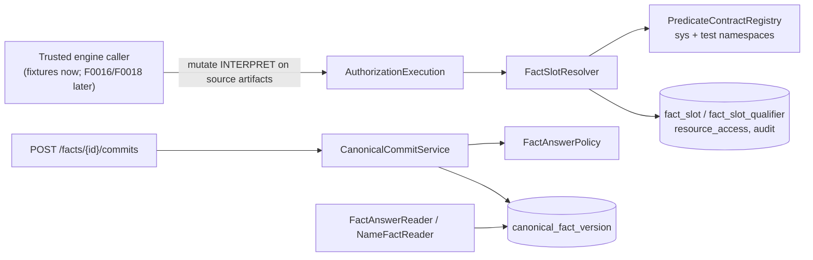

# F0007 — FactSlot model

**Status:** Done / Archived (feature run `2026-11-09-b94cfa12`)
**Archived:** 2026-11-09
**Phase:** v0.1A
**Roadmap:** Completed

## Overview

FactSlot defines canonical semantic identity for every fact; the GL limits in the v0.1 acceptance question are distinct FactSlots (section 13).

Source: `planning-mds/architecture/master-blueprint.md` section 95 (epic roadmap) and section 115.3 (sequencing). Governing ADRs: [ADR-0006](../../../architecture/decisions/ADR-0006-factslot-defines-canonical-semantic-identity.md).

## Requirement-ownership amendment (2026-11-08)

The 2026-11-08 review of the master blueprint against the feature portfolio assigned these requirements to this feature (master blueprint section 106.3). Carry them into the PRD and stories when the feature is planned; the feature status is unchanged.

- **Dependencies:** F0002, F0003, F0006 (previously F0001).
- Carry master blueprint 107.4 and ADR-0039 into the PRD: information state (eight states) is separate from the value, NOT_FOUND/NOT_STATED carry the exact scope searched, and access denial is never an information state. Values use qualified money (exact decimal, ISO 4217 currency, basis) and scoped identifiers (scheme, type, value).
- Carry 109.1: define FactSlot identity beyond the first scalar example (multi-valued, qualified and relationship slots). FactSlot keys are the predicate key referenced by the ADR-0038 SourceAuthorityPolicy owned by F0018.
- New tenant-owned tables bind child rows and foreign keys to tenant ownership and follow the ADR-0042 row-security pattern settled in F0018 Phase B.

## Documents

- [PRD](PRD.md): scope, data requirements, access rules, and the G1 clarifications from 2026-11-09
- [Personas](personas.md) and [acceptance checklist](acceptance-criteria-checklist.md) (39 ACs)
- [STATUS](STATUS.md): plan run `2026-11-09-60865e32` (A+B, new)
- [Feature assembly plan](feature-assembly-plan.md) and Proposed [ADR-0077](../../../architecture/decisions/ADR-0077-factslot-identity-and-typed-answer-carriers.md): Phase B design approved by operator 2026-11-09
- [Worked examples](worked-examples.md), [contract examples](contract-examples.json) and [GETTING-STARTED](GETTING-STARTED.md)
- Design schemas: [fact-slot-key-v1](../../../schemas/fact-slot-key-v1.schema.json), [fact-answer-v1](../../../schemas/fact-answer-v1.schema.json), [fact-slot-resolution-result-v1](../../../schemas/fact-slot-resolution-result-v1.schema.json)

The feature shard is `planning-mds/kg-source/features/F0007.yaml`.

## Feature ERD



```text
entity_knowledge_base (entity, tenant, KB)
   │ subject / object (identity-v1 only)
   ▼
fact_slot ──1:N── fact_slot_qualifier      (authoritative identity parts)
   │  └─1:N── fact_slot (MULTI member, parent_slot_id + member_key)
   └─1:N── canonical_fact_version          (F0008-owned; value = fact-answer/v1 for v1 slots)
legacy pilot fact_slot: identity columns NULL, slot_type kept, no qualifiers
```

## Component View



## Stories

| ID | Title | Status |
|----|-------|--------|
| [F0007-S0001](F0007-S0001-resolve-stable-factslot-identity.md) | Resolve stable FactSlot identity | Not Started |
| [F0007-S0002](F0007-S0002-distinguish-single-multi-and-relationship-slots.md) | Distinguish single, multi-valued and relationship slots | Not Started |
| [F0007-S0003](F0007-S0003-carry-information-state-separately-from-value.md) | Carry information state separately from value | Not Started |
| [F0007-S0004](F0007-S0004-type-money-and-identifiers.md) | Type money and identifiers | Not Started |
| [F0007-S0005](F0007-S0005-define-name-factslots.md) | Define name FactSlots | Not Started |
| [F0007-S0006](F0007-S0006-preserve-pilot-slots-and-ownership.md) | Preserve pilot slots and ownership | Not Started |

**Total Stories:** 6

## Statements, time, and governance scope amendment (2026-09-25)

[ADR-0066](../../../architecture/decisions/ADR-0066-names-are-time-bounded-claims.md) govern this planned work. Carry these requirements into the feature PRD and stories when the feature is planned; the feature status is unchanged. Examples: [statements, time, and governance](../../../examples/statements-time-and-governance.md).

- Define the name FactSlots: `hasLegalName` (single-valued per valid time), `hasTradeName`, `hasFormerName`, and `knownAs` (multi-valued). An entity's display name is selected from its current name facts (ADR-0066, EX-SEM-008).
- **v0.1 scope guard (validate finding P-2):** this feature's Phase A admits only the storage fields, contract checks, and review/display hooks listed here. Alignment, automated deciders, fingerprint-driven scheduling, and time-mention resolution that replaces template fields stay in v0.2+ unless the operator amends the scope (BLUEPRINT §4.11).
