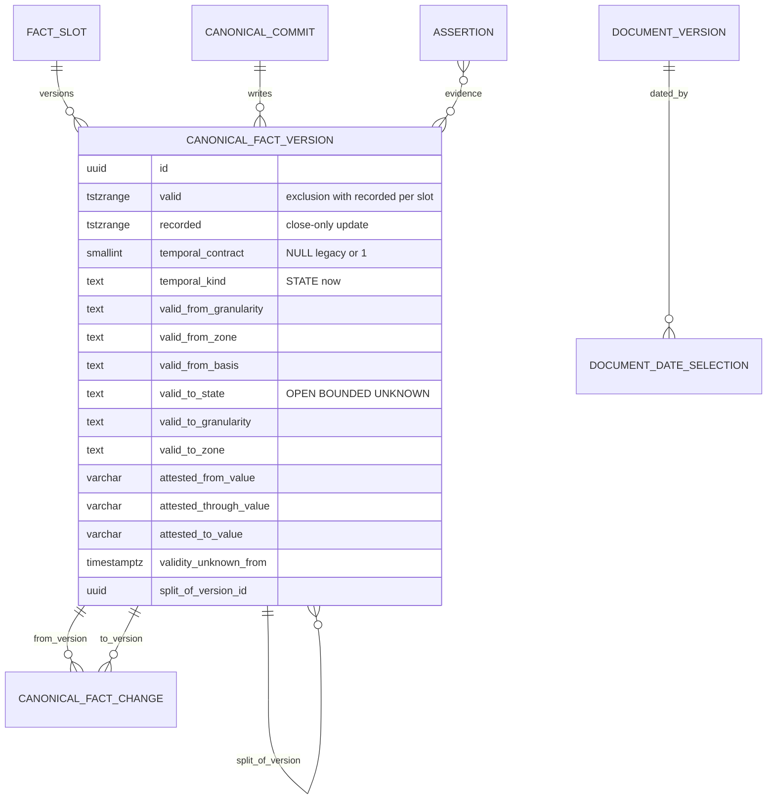
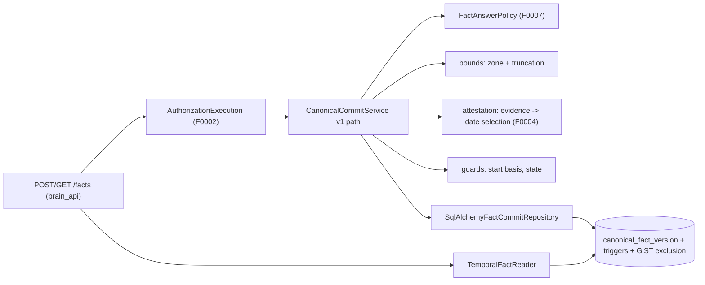

# F0008 — Bitemporal canonical facts

**Status:** Done / Archived — feature run `2026-11-17-1a4ae2f0`, operator approved 2026-11-18
**Archived:** 2026-11-18
**Phase:** v0.1A
**Roadmap:** Completed
**Plan Run:** `2026-11-16-208a1193` (A+B, new)

## Overview

Full bitemporality with database-level overlap integrity is required before the endorsement slice can be proven (sections 14, 15, 109.2).

Source: `planning-mds/architecture/master-blueprint.md` section 95 (epic roadmap) and section 115.3 (sequencing). Governing ADRs: [ADR-0007](../../../architecture/decisions/ADR-0007-full-bitemporality.md), [ADR-0008](../../../architecture/decisions/ADR-0008-database-level-temporal-integrity.md).

## Requirement-ownership amendment (2026-11-08)

The 2026-11-08 review of the master blueprint against the feature portfolio assigned these requirements to this feature (master blueprint section 106.3). Carry them into the PRD and stories when the feature is planned; the feature status is unchanged.

- **Dependencies:** F0003, F0007 (previously F0001).
- The ADR-0039 information state is versioned bitemporally like a value; a later NOT_STATED or EXPLICIT_NEGATIVE supersedes NOT_PROCESSED without erasing it.

## Documents

- [PRD](PRD.md): scope, G1 decisions, assumptions A1–A4 and dependencies
- [Personas](personas.md): Ingrid, Rosa, Priya and Mateo (existing personas)
- [Acceptance criteria checklist](acceptance-criteria-checklist.md): 46 ACs across seven stories
- [STATUS](STATUS.md): story and role progress and the G1 clarifications

- [Feature assembly plan](feature-assembly-plan.md): Phase B design (migration 0014, the v1 commit and read algorithms, the validation matrix)
- [GETTING-STARTED](GETTING-STARTED.md): file map and gotchas
- [Contract examples](contract-examples.json): 20 structural cases for `fact-temporal/v1`
- [ADR-0078](../../../architecture/decisions/ADR-0078-bitemporal-version-contract-and-close-only-immutability.md) (Proposed) and [`fact-temporal-v1.schema.json`](../../../schemas/fact-temporal-v1.schema.json)

The feature shard is `planning-mds/kg-source/features/F0008.yaml`.

## Proposed Data Model (ER)

## Component View

## Stories

| ID | Title | Status |
|----|-------|--------|
| [F0008-S0001](F0008-S0001-record-valid-time-precision-and-zone.md) | Record valid-time precision and zone | Done |
| [F0008-S0002](F0008-S0002-distinguish-open-bounded-and-unknown-ends.md) | Distinguish open, bounded and unknown ends | Done |
| [F0008-S0003](F0008-S0003-split-intervals-and-close-recorded-time.md) | Split intervals and close recorded time | Done |
| [F0008-S0004](F0008-S0004-enforce-temporal-integrity-under-concurrency.md) | Enforce temporal integrity under concurrency | Done |
| [F0008-S0005](F0008-S0005-guard-succession-by-start-basis-and-state.md) | Guard succession by start basis and state | Done |
| [F0008-S0006](F0008-S0006-resolve-facts-at-a-valid-and-recorded-coordinate.md) | Resolve facts at a valid and recorded coordinate | Done |
| [F0008-S0007](F0008-S0007-preserve-pilot-versions-through-migration.md) | Preserve pilot versions through migration | Done |

**Total Stories:** 7

## Statements, time, and governance scope amendment (2026-09-25)

[ADR-0064](../../../architecture/decisions/ADR-0064-time-interpretation-and-valid-time-precision.md) govern this planned work. Carry these requirements into the feature PRD and stories when the feature is planned; the feature status is unchanged. Examples: [statements, time, and governance](../../../examples/statements-time-and-governance.md).

- Store per-bound granularity, `valid_to_state` (`OPEN`, `BOUNDED`, `UNKNOWN`), and `attested_from`/`attested_to`. Settle how `UNKNOWN` ends are represented inside the ADR-0008 exclusion constraint; the recommended option is in ADR-0064. Reads distinguish unknown from open and never widen a missing start to negative infinity.
- A successor closes a predecessor in a single-valued slot only when its start is grade `A` or `B`, never on model confidence.
- **v0.1 scope guard (validate finding P-2):** this feature's Phase A admits only the storage fields, contract checks, and review/display hooks listed here. Alignment, automated deciders, fingerprint-driven scheduling, and time-mention resolution that replaces template fields stay in v0.2+ unless the operator amends the scope (BLUEPRINT §4.11).
