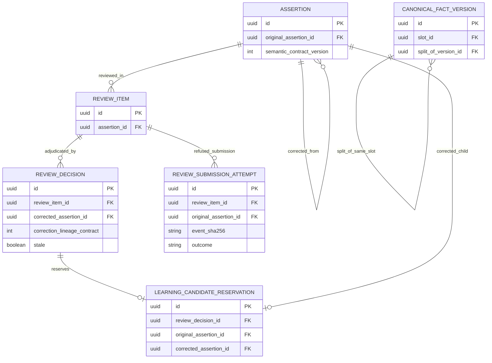
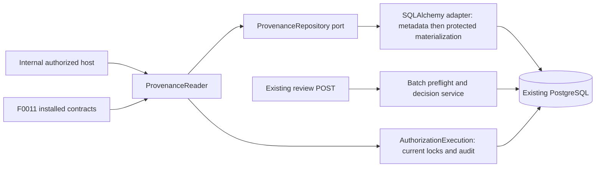

# F0009 — Provenance + human-correction lineage

**Status:** Done / Archived 2026-11-25 (feature run `2026-11-24-08701e37`)
**Phase:** v0.1A
**Roadmap:** Now (2026-11-20 roadmap review)
**Plan Run:** `2026-11-24-bfdbbf04`
**Planning:** Phase A approved 2026-11-24; Phase B approved 2026-11-24 by operator token `approve-phase-b`

## Overview

No authoritative fact exists without evidence, and human corrections append with lineage that feeds the Golden Corpus (sections 17, 75).

Source: `planning-mds/architecture/master-blueprint.md` section 95 (epic roadmap) and section 115.3 (sequencing). Governing ADRs: [ADR-0010](../../../architecture/decisions/ADR-0010-provenance-is-mandatory.md), [ADR-0037](../../../architecture/decisions/ADR-0037-human-corrections-append-they-do-not-rewrite-evidence.md).

## Requirement-ownership amendment (2026-11-08)

The 2026-11-08 review of the master blueprint against the feature portfolio assigned these requirements to this feature (master blueprint section 106.3). Carry them into the PRD and stories when the feature is planned; the feature status is unchanged.

- **Dependencies:** F0006, F0008 (previously F0001).
- Carry the master blueprint 88 LearningCandidate hook: human corrections persist a reserved LearningCandidate reference for the Golden Corpus. No learning behaviour ships in v0.1 (F0041 owns it).

## Shipped contract carry-in: ADR-0077/ADR-0078 (2026-11-21)

F0007 and F0008 shipped [ADR-0077](../../../architecture/decisions/ADR-0077-factslot-identity-and-typed-answer-carriers.md) (FactSlot identity, `fact-answer/v1`) and [ADR-0078](../../../architecture/decisions/ADR-0078-bitemporal-version-contract-and-close-only-immutability.md) (`fact-temporal/v1`, close-only versions). Both are Accepted. The handoffs below come from those records' Consequences sections. Bind Phase B to the as-built contract (master blueprint sections 13 and 14, "As built"), not to the original sketch. The feature status is unchanged.

- Provenance lineage reads remainder `split_of_version_id` (bound to the same slot by migration 0015) and the append-only `canonical_fact_change` rows (ADR-0078 consequences).
- Version rows are close-only: the database refuses UPDATE (except the single recorded close), DELETE and TRUNCATE. Correction lineage must append and must not rewrite a version.
- Ending evidence is stored in the version's `evidence` JSONB as `ending_refs`. A correction of a version-2 assertion is a version-2 child assertion (ADR-0075).

## Documents

| Document | Purpose |
|---|---|
| [PRD](PRD.md) | Phase A requirements and scope assumptions |
| [Personas](personas.md) | Existing persona jobs and boundaries |
| [Acceptance checklist](acceptance-criteria-checklist.md) | 41 ACs and required runtime proof |
| [STATUS](STATUS.md) | Done; required signoffs recorded in feature run `2026-11-24-08701e37` |
| [GETTING-STARTED](GETTING-STARTED.md) | Planning resume and carry-in guide |
| [Worked examples](worked-examples.md) | Synthetic EX-PROV-001–005 and expected boundaries |

## Stories

| ID | Title | Status |
|---|---|---|
| [F0009-S0001](F0009-S0001-reconstruct-source-provenance.md) | Reconstruct source provenance | Done |
| [F0009-S0002](F0009-S0002-append-auditable-human-corrections.md) | Append auditable human corrections | Done |
| [F0009-S0003](F0009-S0003-trace-temporal-version-lineage.md) | Trace temporal version lineage | Done |
| [F0009-S0004](F0009-S0004-enforce-current-authority-across-lineage.md) | Enforce current authority across lineage | Done |
| [F0009-S0005](F0009-S0005-reserve-learning-candidate-reference.md) | Reserve a learning-candidate reference | Done |
| [F0009-S0006](F0009-S0006-prove-compatible-lineage-delivery.md) | Prove compatible lineage delivery | Done |

**Total Stories:** 6
**Completed:** 0 / 6

## Architecture review

Phase A approved at G3 with operator token `approve-phase-a` (2026-11-24). Phase B approved 2026-11-24 by operator token `approve-phase-b`. Phase B rework run `2026-11-24-c32acf46` (refused-attempt replay and provenance edge semantics, plan-review PR-H1/PR-H2) was approved the same day with `approve-phase-b`. G4 and all seven ordered G5 pre-approval operations passed; the G5 journal records post-approval regeneration and publication. No runtime completion, formal ADR acceptance or build readiness is asserted.

| Artifact | Design status |
|---|---|
| [Assembly plan](feature-assembly-plan.md) | Five-step Python implementation specification; all 41 ACs mapped |
| [ADR-0080](../../../architecture/decisions/ADR-0080-bounded-provenance-and-correction-reservations.md) | Proposed; runtime proofs and separate acceptance required |
| [Contract inventory](contract-inventory.yaml) | Four new schemas plus existing closed dependencies; no runtime bundle changes at plan |
| [Migration design](migration-design.sql) | Two new tables, one nullable server marker; no legacy backfill |
| [Contract examples](contract-examples.json) | Synthetic structural expectations, no runtime proof |


## Feature ERD

New tables are proposed; the other records already exist. A reservation is a future identity only; no learning candidate processor is added.



```text
original Assertion <- corrected_from - HUMAN_REVIEW child
       | ReviewItem -> ReviewDecision -> reserved future learning UUID
       +-----------> refused-submission attempt (no child/reservation)
exact canonical version -> split predecessor / change endpoints / evidence
```

## Component view



The existing [C4 L1](../../../architecture/c4-context.md) and [C4 L2](../../../architecture/c4-container.md) topology is unchanged. No cache, model producer, route, grant or deployable is added. Full mutation/authorization/rollback detail is in the assembly plan.
